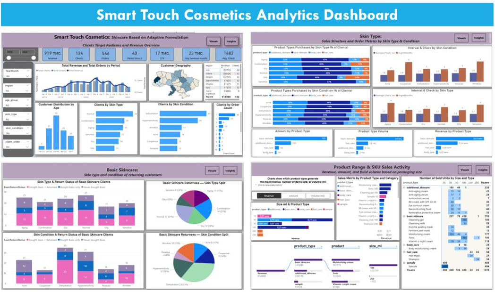
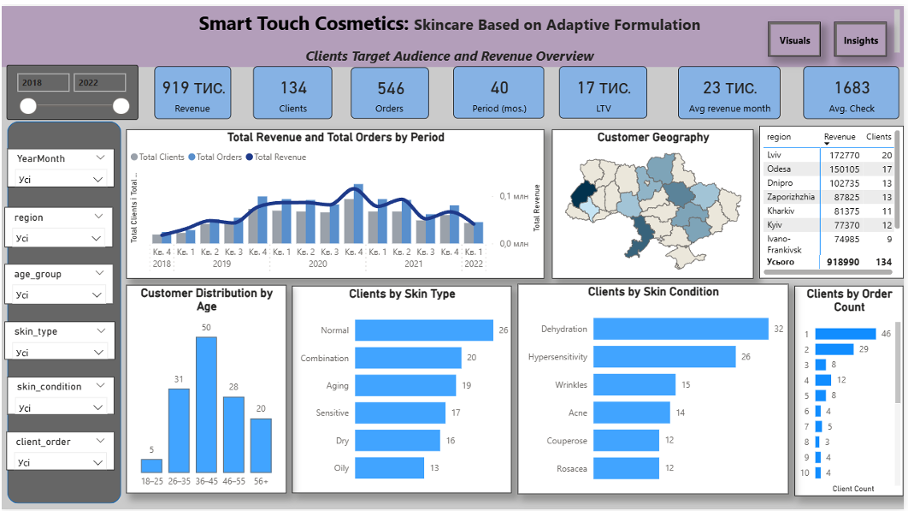
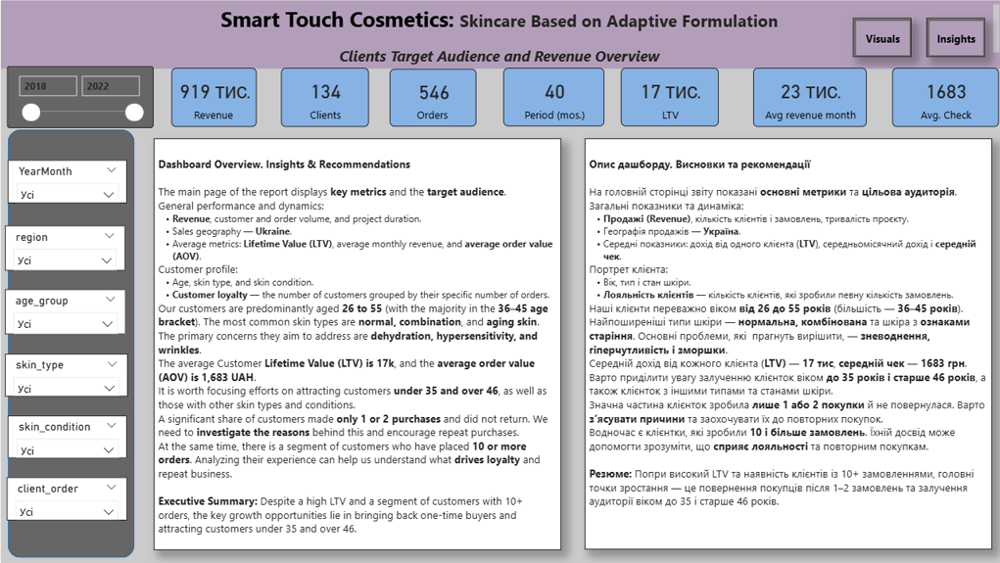
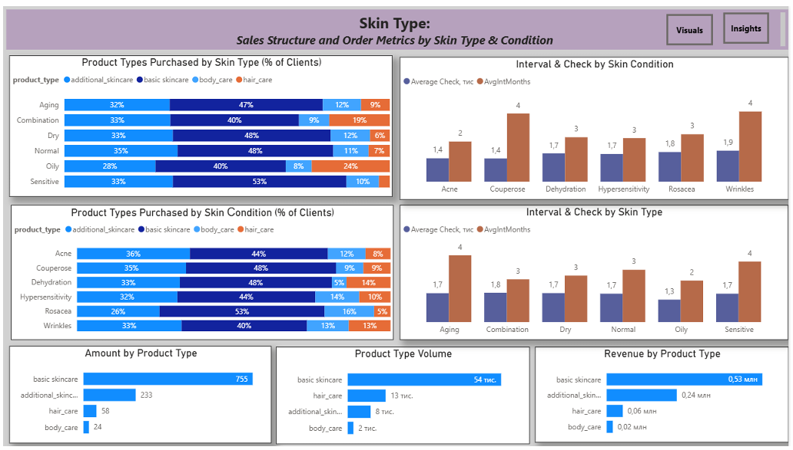
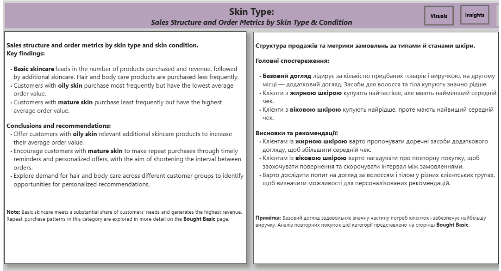
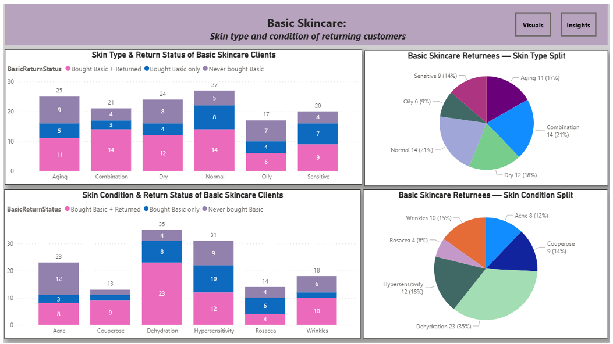
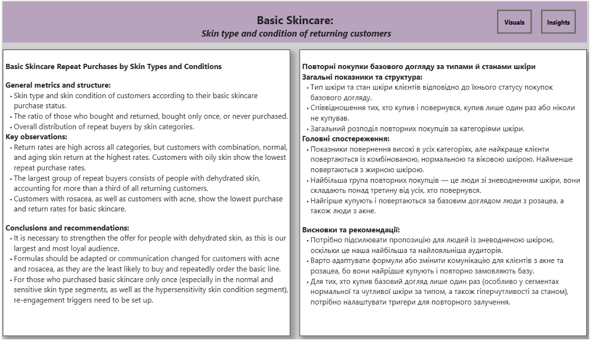
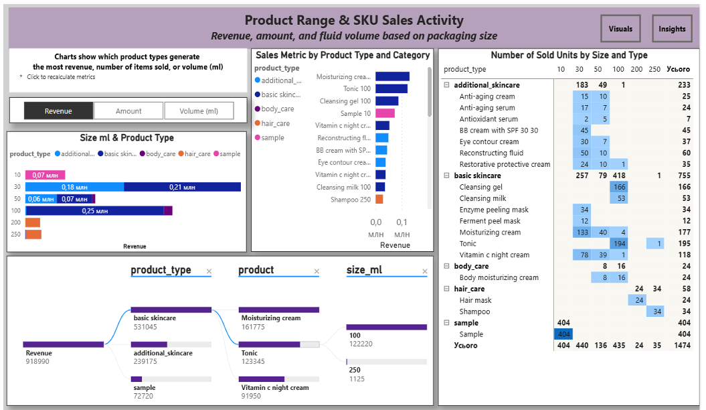
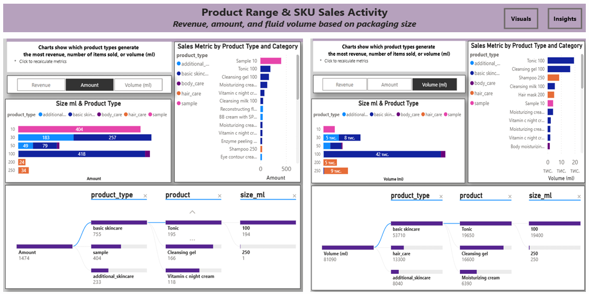
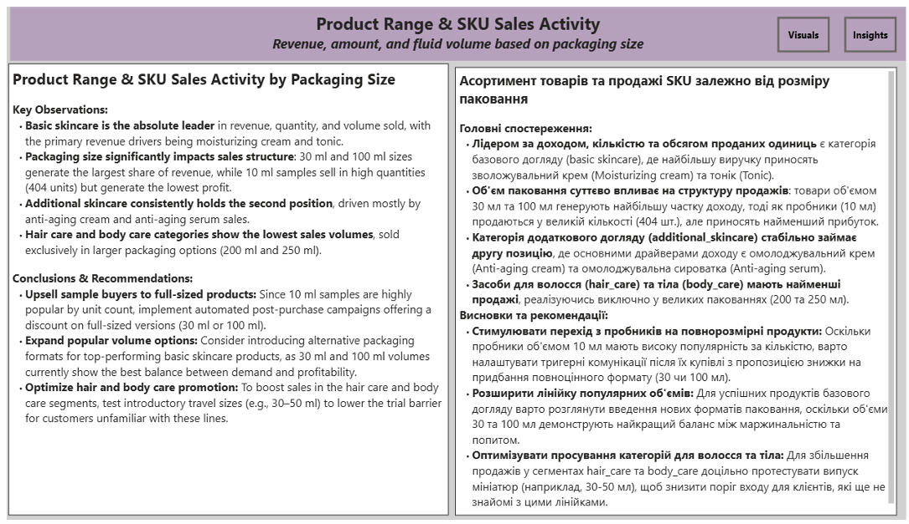

# 📊 Детальний аналіз доходу, асортименту та купівельної поведінки клієнток (Звіт 1)

*Кореневий файл усього звіту:*

---

## 1. Огляд цільової аудиторії та виручки

**Smart Touch Cosmetics: Skincare Based on Adaptive Formulation**
Бренд орієнтований на жіночу аудиторію, тому аналіз сфокусовано на дослідженні потреб та купівельної поведінки клієнток компанії.

### 🔍 Що аналізується:
*   **Ключові метрики:** загальна виручка, кількість клієнтів і замовлень, тривалість проєкту, LTV, середньомісячна виручка та середній чек.
*   **Динаміка продажів:** співвідношення кількості клієнтів, замовлень і виручки в часі.
*   **Географія продажів:** розподіл продажів за регіонами України з використанням інтерактивної карти.
*   **Портрет клієнта:** кількість клієнток за віковими групами, типами та станами шкіри.
*   **Купівельна активність:** розподіл клієнтів за кількістю здійснених замовлень.

### 📈 Результати аналізу:
Основу клієнтської аудиторії становлять покупці віком 26–55 років, найбільша група — 36–45 років. Найпоширеніші типи шкіри — нормальна та комбінована, а серед станів шкіри часто зустрічаються ознаки старіння, зневоднення, гіперчутливість і зморшки.

Середній дохід на клієнта (LTV) становить близько 17 тис. грн, середній чек — 1 683 грн.
Значна частина клієнток зробила лише одну або дві покупки. Клієнти молодших і старших вікових груп, а також покупці з деякими типами й станами шкіри є менш представленими в загальній структурі.

### 🖥️ Візуалізація дашборду:

---

### 💡 Висновки та рекомендації:

*   Звіт характеризує цільову аудиторію Smart Touch Cosmetics, її купівельну активність і фінансові показники клієнтів. Аналіз показує, які вікові групи та типи шкіри представлені серед покупців, як змінювалися продажі та скільки замовлень здійснюють клієнтки. Ці дані дають основу для подальшого аналізу клієнтської поведінки та розвитку бізнесу.
*   Варто дослідити причини відсутності повторних замовлень і визначити способи стимулювання повернення клієнтів. Водночас аналіз клієнтів із великою кількістю замовлень може допомогти зрозуміти, що сприяє лояльності.
*   Додаткові можливості для розвитку — залучення клієнтів молодших і старших вікових груп та краще розуміння потреб аудиторії з менш представленими типами й станами шкіри.

---

## 2. Типи та стани шкіри: структура продажів і метрики замовлень

**Skin Type: Sales Structure and Order Metrics by Skin Type & Condition**

### 🔍 Що аналізується:
*   **Вибір категорій продуктів:** який відсоток клієнток із певним типом або станом шкіри купує кожну категорію продуктів.
*   **Продажі за типами продуктів:** кількість покупок, об’єм у мілілітрах і виручка. Порівняння цих показників дає змогу побачити, які категорії переважають у продажах.
*   **Поведінка покупців:** середній інтервал між покупками в місяцях і середній чек клієнток залежно від типу та стану шкіри.

### 📈 Результати аналізу:
Базовий догляд переважає серед покупок клієнток із різними типами та станами шкіри, а також лідирує за кількістю покупок, об’ємом у мілілітрах і виручкою. Це свідчить про те, що саме цими засобами можна задовольнити більшість потреб клієнток.

Додатковий догляд посідає наступне місце, тоді як засоби для волосся й тіла купують рідше. Взаємозв'язок між інтервалом та чеком показує загальну тенденцію: клієнтки, які купують рідше, зазвичай мають вищий середній чек.

### 🖥️ Візуалізація дашборду:

---

### 💡 Висновки та рекомендації:

*   Доцільно зосередити розвиток асортименту на базовому догляді, а додаткові засоби пропонувати як доповнення до основних потреб клієнток з урахуванням їхнього типу та стану шкіри.
*   Для підвищення середнього чека варто перевірити, чи можна стимулювати частіші покупки за допомогою наборів базового догляду та персоналізованих пропозицій.

---

## 3. Базовий догляд: повторні покупки

**Basic Skincare: Skin Type and Condition of Returning Customers**

### 🔍 Що аналізується:
*   **Кількість клієнток і тип або стан їхньої шкіри:** аналіз та порівняння сегментів клієнток, які купували базовий догляд і поверталися за повторною покупкою, купували його лише один раз або взагалі ніколи не купували продукцію з цієї лінійки.
*   **Профіль лояльних клієнток:** визначення того, який саме тип і стан шкіри мають клієнтки, що здійснювали повторні покупки базового догляду.

### 📈 Результати аналізу:
*   **Одиничні покупки та відсутність замовлень:** у групі тих, хто купував базовий догляд лише один раз, найчастіше зустрічаються нормальна та чутлива шкіра (за типом) та гіперчутливість (за станом). Серед жінок, які ніколи не купували базовий догляд, переважають вікова та суха шкіра, а головний стан — акне.
*   **Повторні покупки:** клієнтки, які поверталися за повторними покупками, найчастіше мають комбіновану, нормальну або вікову шкіру (найменше — жирну). Серед станів шкіри лідирує зневоднення, далі йдуть гіперчутливість і купероз (найменше — розацеа).
*   **Критичні точки:** найбільша кількість повторних покупок зафіксована у клієнток із зневодненням шкіри. Водночас у чисельних групах нормальної шкіри, гіперчутливості та акне спостерігається велика кількість тих, хто йде після першої ж покупки або взагалі уникає лінійки базового догляду.

### 🖥️ Візуалізація дашборду:

---

### 💡 Висновки та рекомендації:

*   Повторні покупки базового догляду пов’язані з різними типами та станами шкіри, однак не в усіх групах клієнтки повертаються за наступною покупкою.
*   Необхідно детально з’ясувати причини, чому клієнтки з нормальною шкірою, гіперчутливістю та акне часто не повертаються за повторною покупкою базового догляду. 
*   Варто перевірити, які саме засоби вони купували вперше, чи відповідали вони реальним потребам їхньої шкіри та чи купували ці клієнтки інші продукти бренду надалі. Це допоможе визначити, чи пов’язана відсутність повторних покупок із вибором конкретного засобу або переходом до інших лінійок, і на цій основі сформувати персоналізовані пропозиції для підвищення retention-метрики.

---

## 4. Асортимент продукції та активність продажів за SKU

**Product Range & SKU Sales Activity**

### 🔍 Що аналізується:
Комплексний аналіз асортименту за типами продуктів, розмірами упаковок та окремими товарними позиціями (SKU), а також показників їхніх продажів. Для перших трьох графіків реалізовано інтерактивний вибір метрики: *виручка, кількість проданих одиниць або об’єм продажів у мілілітрах*.
*   **Розміри упаковок і типи продуктів:** відображає, у яких розмірах упаковок представлений кожен продукт, а також його виручку, кількість проданих одиниць і об’єм (мл).
*   **Продажі за типами та категоріями продуктів:** порівняння показників продажів різних категорій для визначення найбільш маржинальних та затребуваних товарів.
*   **Продажі за типами продуктів, найменуваннями та розмірами упаковок:** деталізація показників продажів до найнижчого рівня (SKU).
*   **Кількість проданих одиниць за розміром упаковки та типом продукту:** матрична структура доступності об'ємів для кожної позиції та обсяги їх збуту.

### 📈 Результати аналізу:
*   **Лідери продажів:** базовий догляд за шкірою приносить найбільшу виручку та кількість продажів. Основними драйверами є тонік, зволожувальний крем та очищувальний гель з найвищим попитом на об'єм 100 мл.
*   **Пробники та набори:** набори зразків у форматі 10 мл посідають друге місце за кількістю куплених одиниць, але мають мінімальну частку у виручці та загальному об'ємі рідини.
*   **Специфіка категорій:** категорія догляду за волоссям представлена виключно у великих упаковках по 200 та 250 мл, через що формує високий сумарний літраж при низькій кількості замовлень. Найменшу результативність за всіма бізнес-показниками демонструють товари для додаткового догляду та догляду за тілом.

### 🖥️ Візуалізація дашборду:

---

### 💡 Висновки та рекомендації:

*   Найвищі показники виручки мають тонік і зволожувальний крем, а за кількістю проданих одиниць лідирують набори зразків. Продажі суттєво відрізняються залежно від розмірів упаковок, і великий об’єм продажів у мілілітрах не обов’язково означає більшу кількість транзакцій.
*   Рекомендується розробити маркетингові тригери для стимулювання переходу клієнтів з пробників (10 мл) на повнорозмірні продукти. 
*   Для успішних продуктів базового догляду варто розглянути введення нових форматів паковання. 
*   В категоріях додаткового догляду та догляду за тілом необхідно переглянути лінійку об’ємів, зосередившись на форматах із найбільшим попитом, та оптимізувати стратегію просування категорій для волосся та тіла.
