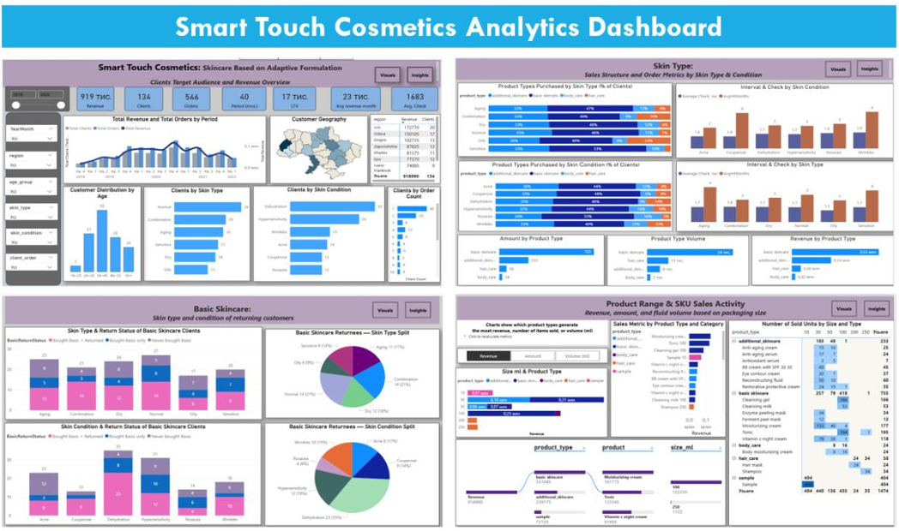
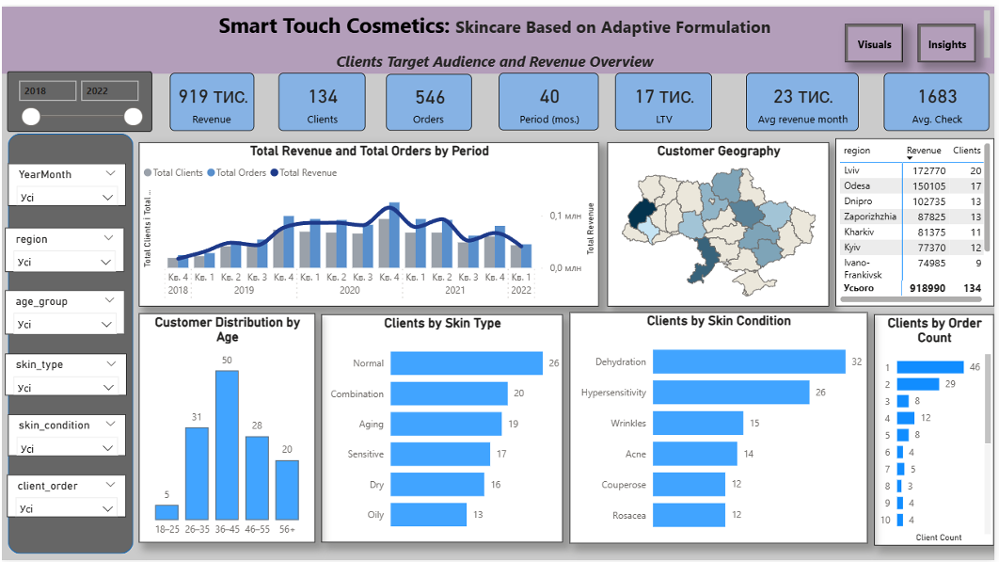
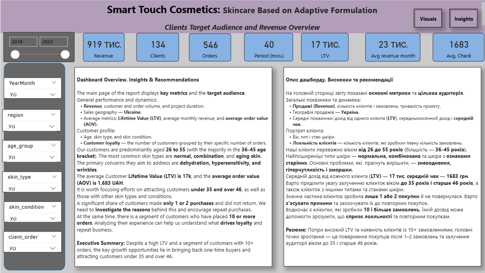
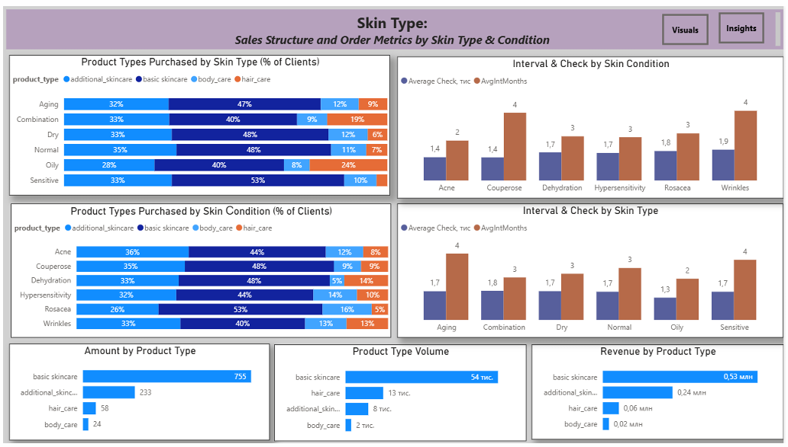
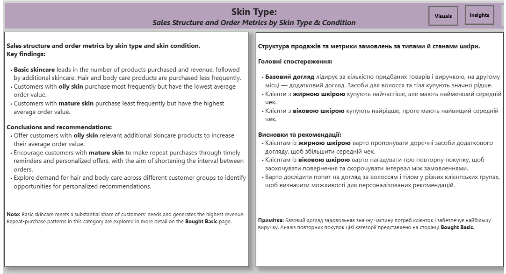

# 📊 Detailed Analysis of Revenue, Assortment, and Purchasing Behavior (Report 1)

*Main report file reference:*

---

## 1. Target Audience and Revenue Overview

**Smart Touch Cosmetics: Skincare Based on Adaptive Formulation**
Given the brand's female-centric target audience, the evaluation isolates the core needs and purchasing behavior of the company's female customer base.

### 🔍 What is Analyzed:
*   **Key Metrics:** Total revenue, distinct customer count, order volumes, project timeframe, LTV, monthly revenue runs, and average order value (AOV).
*   **Sales Dynamics:** Core relations between total customers, order counts, and total revenue values over time.
*   **Sales Geography:** Geographic order distribution across Ukrainian regions mapped via an interactive map visual.
*   **Customer Profile:** Demographic segments grouped by age brackets, skin types, and skin conditions.
*   **Purchasing Frequency:** Distribution of customers based on the exact count of completed transactions.

### 📈 Analytical Results:
The primary customer base consists of buyers aged 26–55, with the 36–45 cohort forming the largest segment. Normal and combination skin are the most common skin types, while skin conditions frequently show signs of aging, dehydration, hypersensitivity, and wrinkles.

The average lifetime value (LTV) per client centers around 17,000 UAH, with an AOV of 1,683 UAH. A significant portion of buyers made only one or two purchases. Younger and older age brackets, alongside specific skin profiles, remain underrepresented in the overall sales structure.

### 🖥️ Dashboard Visualization:

---

### 💡 Conclusions & Recommendations:

*   This dashboard establishes a clean baseline of the Smart Touch Cosmetics target audience and financial performance. It pinpoints exactly which profiles drive revenue, how sales trend over time, and client order frequency.
*   It is critical to investigate the root causes behind single-purchase customers and build tailored marketing triggers to boost retention. Concurrently, analyzing high-frequency accounts will unlock deeper insights into customer loyalty.
*   Growth opportunities lie in expanding market share among underrepresented age groups and tailoring product visibility to less common skin conditions.

---

## 2. Skin Types and Conditions: Sales Structure and Order Metrics

**Skin Type: Sales Structure and Order Metrics by Skin Type & Condition**

### 🔍 What is Analyzed:
*   **Category Penetration:** The percentage of customers within specific skin profiles purchasing particular product categories.
*   **Sales by Product Types:** Comparative evaluation of units sold, total volume in milliliters, and gross revenue to identify dominant product offerings.
*   **Buyer Behavior:** Calculations of average purchasing intervals (in months) and average order value (AOV) mapped across distinct skin types and conditions.

### 📈 Analytical Results:
The Basic Skincare line heavily dominates purchases across all skin profiles, leading in total transactions, fluid volume sold, and generated revenue. This highlights Basic Skincare as the core solution meeting the majority of customer needs.

Advanced Skincare captures the second-largest share, while hair and body care products are purchased significantly less frequently. A clear behavior pattern emerges: customers with longer purchasing intervals tend to spend more per transaction, driving a higher average order value.

### 🖥️ Dashboard Visualization:

---

### 💡 Conclusions & Recommendations:

*   Product development and stock allocations should prioritize the Basic Skincare line, positioning advanced treatments as personalized add-ons tailored to specific skin concerns.
*   To optimize purchasing frequency without sacrificing order value, the business should test bundling basic care packages and deploying automated, skin-specific replenishing offers.
