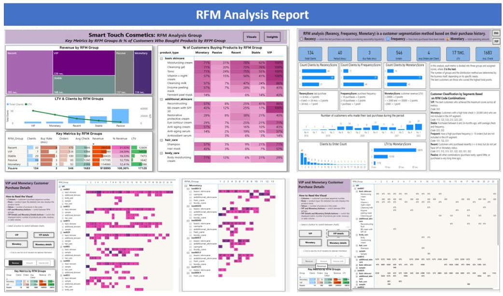
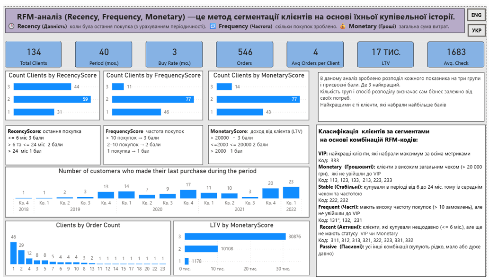
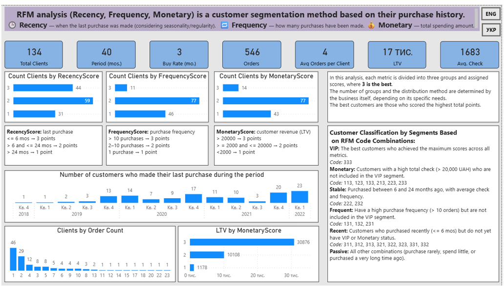
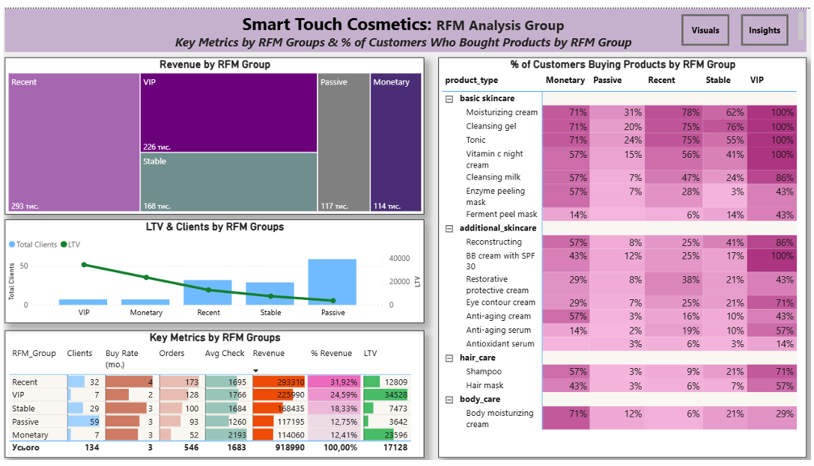
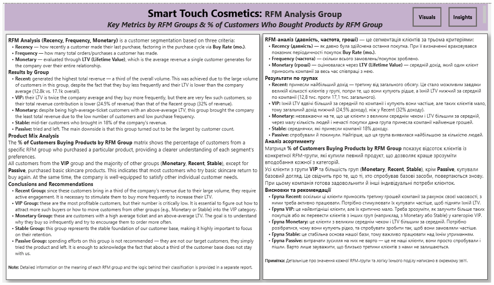
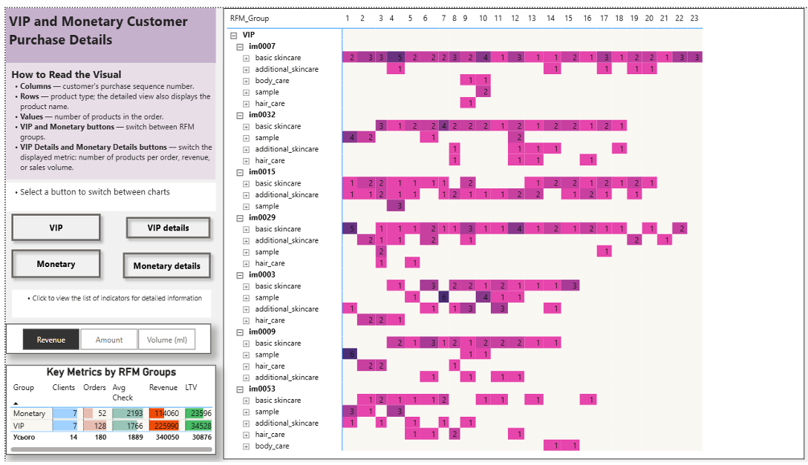
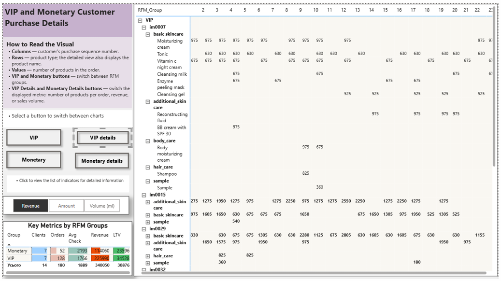
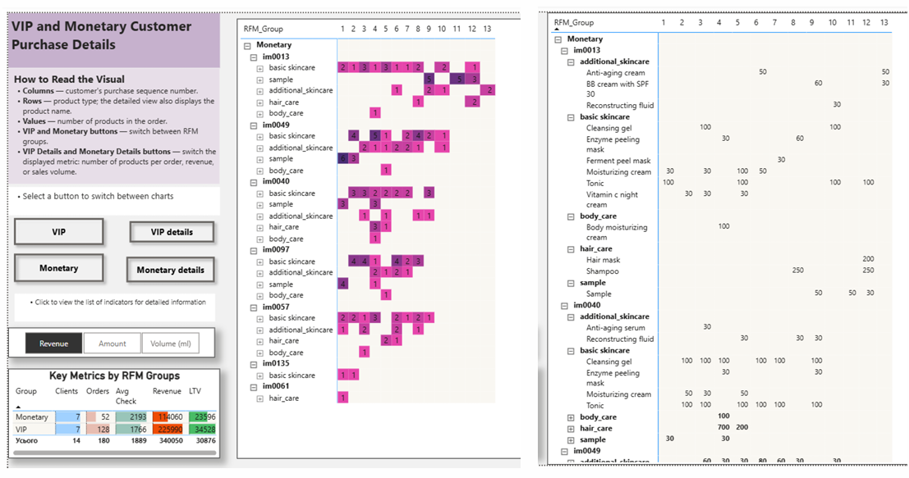

# 📊 Детальний звіт з RFM-аналізу клієнтів (Звіт 2)

*Кореневий файл усього звіту:*

---

## 1. Пояснення методології та критеріїв сегментації

До звіту додано детальне роз'яснення того, як саме відбувався поділ клієнтів на групи та які ключові бізнес-метрики були використані як основа для визначення меж при присвоєнні балів.

У цьому аналізі зроблено розподіл кожного показника на три групи з присвоєнням балів, де **3 — найкращий результат**. Кількість груп та спосіб розподілу бізнес визначає індивідуально під свої потреби, а найціннішими є клієнти з найвищим сумарним балом.

### 🎯 Метрики для оцінки:
*   **RecencyScore (давність):** розраховано на основі тривалості проєкту та часових інтервалів між покупками.
*   **FrequencyScore (частота):** базується на кількості замовлень загалом та в середньому на одного клієнта.
*   **MonetaryScore (гроші):** визначено через показник LTV та середній чек.

### 📊 Додаткові аналітичні розрізи на графіках:
*   Кількість клієнтів у кожному показнику в розрізі балів.
*   Відтік клієнтів у динаміці по кварталах.
*   Розподіл бази за кількістю здійснених замовлень.
*   Показник LTV для кожного конкретного бала метрики Monetary.
*   Повна класифікація за сегментами на основі комбінацій RFM-кодів, опис кожної групи та коди, що до неї входять.

### 🖥️ Візуалізація методології:

---

## 2. Аналіз ключових метрик за RFM-групами

**Smart Touch Cosmetics: RFM Analysis Group Key Metrics**

### 🔍 Що аналізується:
Розподіл клієнтської бази на сегменти за трьома показниками (давність, частота, сума витрат) та комплексна оцінка ефективності кожної групи.
*   **Revenue by RFM Group:** загальна частка виручки, яку приносить бізнесу кожна RFM-група.
*   **LTV & Clients by RFM Groups:** порівняння кількісного складу груп із їхньою довічною цінністю (LTV).
*   **Key Metrics by RFM Groups:** зведена матриця показників (кількість клієнтів, темп покупок Buy Rate, обсяг замовлень, середній чек, виручка в грошах та відсотках, LTV).
*   **% of Customers Buying Products by RFM Group:** проникнення категорій (який відсоток клієнтів кожної групи купує конкретні типи продуктів та SKU).

### 📈 Результати аналізу:
*   **Recent (Нові):** генерують найбільшу виручку — **293 тис. грн (майже 32% від загальної суми)**, що свідчить про ефективне поточне залучення нових покупців.
*   **VIP та Stable (Стабільні):** формують ядро лояльних покупців і генерують **майже 40% усього доходу компанії**. Сегмент VIP є найціннішим за показником LTV (налічує 7 клієнтів).
*   **Passive (Пасивні):** найчисленніша група (**59 клієнтів**). Проте вони купували дуже давно, мають найнижчий середній чек та мінімальну кількість замовлень.
*   **Охоплення продуктів:** товари базового догляду (зволожувальний крем, тонік та очищувальний гель) мають **100% охоплення серед VIP-клієнтів** і лідирують в інших групах. Додатковий догляд, засоби для тіла та волосся купують значно рідше.

### 🖥️ Візуалізація дашборду:

---

### 💡 Висновки та рекомендації:

*   **Переведення «середнячків» у прибуткові групи:** оскільки групи *Recent* та *Stable* уже показують хорошу активність, варто стимулювати їх купувати частіше (ростити показник Buy Rate) або піднімати їхній середній чек, щоб переводити клієнтів у розряд *VIP* та *Monetary*.
*   **Ротація пасивних клієнтів:** не варто витрачати маркетинговий бюджет на активацію групи *Passive*, оскільки це давні клієнти, яким продукт, найімовірніше, не підійшов. Фокус уваги та кошти краще перенаправити на перспективні сегменти.
*   **Крос-продажі для нових клієнтів (Recent):** вони активно купують базовий догляд (75-78%). Доцільно пропонувати їм мініатюри або пробники з категорій додаткового догляду чи засобів для волосся у наступних комунікаціях.
*   **Ексклюзивний підхід для VIP та Monetary:** ці групи дають найвищий чек та LTV. Для них важливо підтримувати статусність — пропонувати персональні набори, ранній доступ до новинок та закриті спецпропозиції.

---

## 3. Деталізація покупок клієнтів груп VIP та Monetary

**VIP and Monetary Customer Purchase Details**

### 🔍 Що аналізується:
Глибокий аудит поведінки найбільш прибуткових клієнтів: кількість замовлень кожного клієнта, точний склад кожної транзакції, кількість придбаних товарів та вартість кожного чека.

**🎛️ Інтерактивний функціонал:**
*   Кнопки перемикання між групами **VIP** та **Monetary** для миттєвої зміни контексту даних.
*   Деталізований графік із динамічним вибором аналітичного показника: *кількість товарів (Amount), виручка (Revenue)* або *обсяг продажів у мілілітрах (Volume, ml)*.
*   Повна деталізація до рівня типів товарів та конкретних найменувань продуктів (SKU).

### 🖥️ Візуалізація дашборду:

