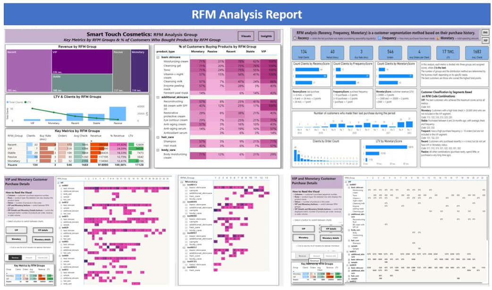
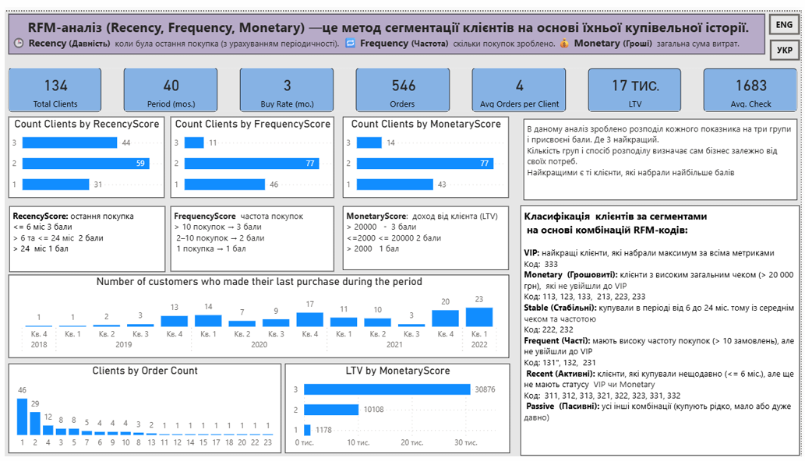
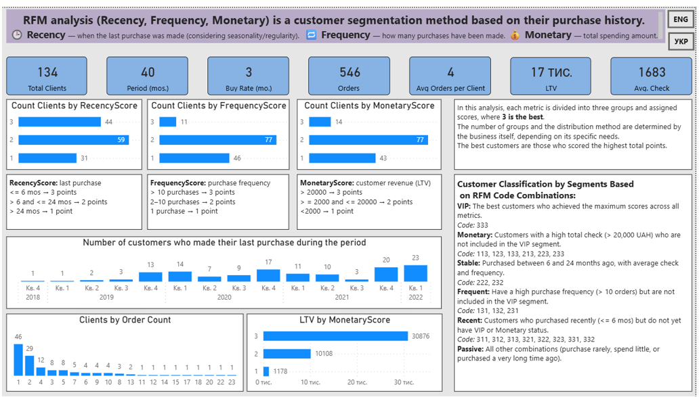
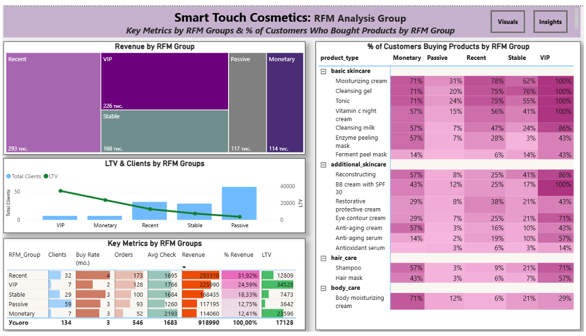
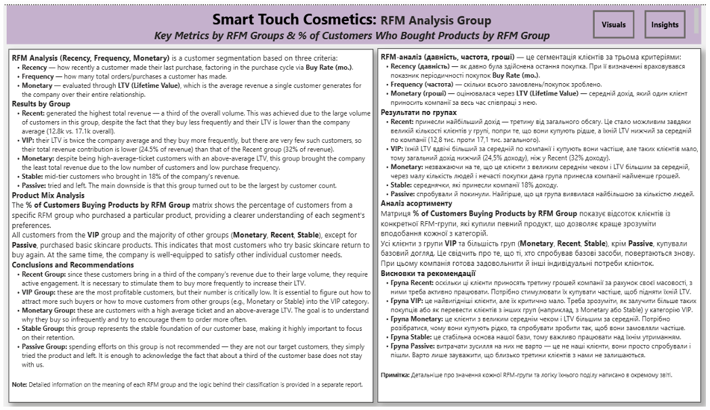
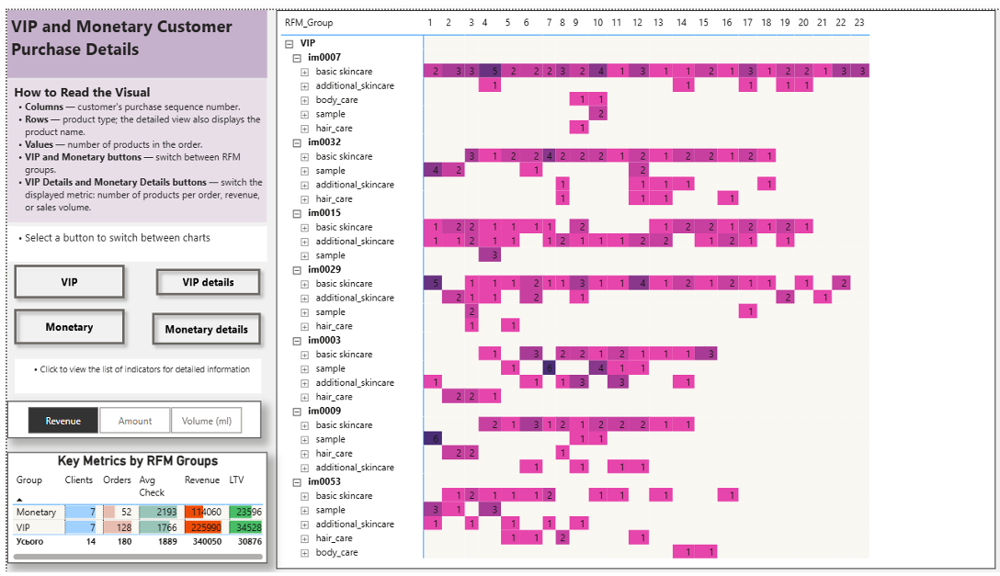
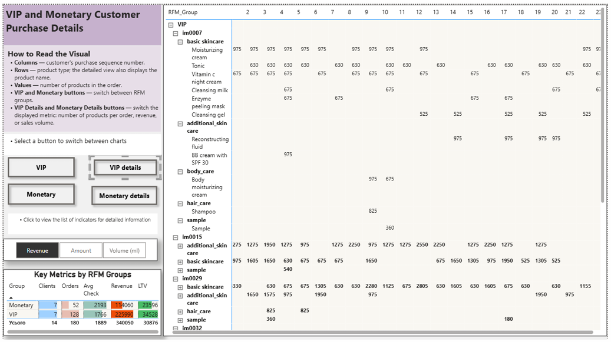
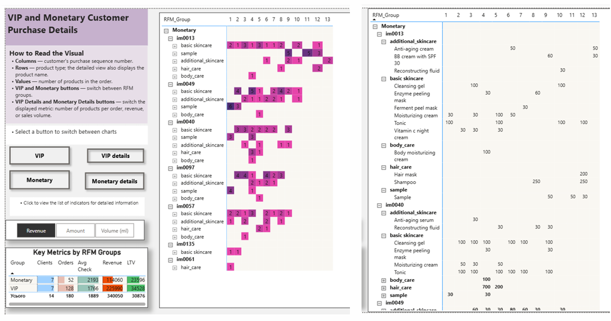

# 📊 Detailed Customer RFM Analysis (Report 2)

*Main report file reference:*

---

## 1. Methodology and Segmentation Boundaries

This report outlines the behavioral segmentation methodology applied to the database, detailing how scores were assigned and which core business boundaries defined the grading limits.

The analysis divides each performance vector into three balanced tiers, where a score of **3 represents the optimal result**. The grading scale is tailored to business models, meaning that customers holding a 3-3-3 matrix reflect the highest-value segment.

### 🎯 Evaluation Vectors:
*   **RecencyScore:** Derived from total project duration and individual days elapsed since the client's last transaction.
*   **FrequencyScore:** Built on total completed orders and the average order frequency per account.
*   **MonetaryScore:** Determined by individual customer lifetime value (LTV) and average spending tiers.

### 📊 Supplementary Visual Granularities:
*   Volume of customers mapped across specific scoring combinations.
*   Quarterly customer churn trends.
*   Database structure by exact order volume counts.
*   LTV yield across specific Monetary score tiers.
*   Comprehensive classification tables explaining what each segment code implies for business operations.

### 🖥️ Methodology Layout:

---

## 2. Key Metrics Across RFM Groups

**Smart Touch Cosmetics: RFM Analysis Group Key Metrics**

### 🔍 What is Analyzed:
Database segmentation cross-referenced with gross business performance to evaluate the absolute value of each behavioral cohort.
*   **Revenue by RFM Group:** Gross financial share generated per segment.
*   **LTV & Clients by RFM Groups:** Headcount size compared against the group's collective Lifetime Value.
*   **Key Metrics Matrix:** A consolidated grid mapping customer count, Buy Rate, total orders, average check, and revenue percentage yields.
*   **Category Penetration Rate:** Granular view tracking the exact percentage of an RFM cohort buying specific SKUs.

### 📈 Analytical Results:
*   **Recent (New Buyers):** Generates the largest revenue volume — **293,000 UAH (nearly 32% of total revenue)**, validating solid short-term acquisition performance.
*   **VIP and Stable:** Form the foundational core of the business, generating **nearly 40% of gross revenue**. The VIP segment yields the highest individual LTV metrics (currently encompassing 7 high-value buyers).
*   **Passive:** Represents the largest distinct cohort (**59 clients**). However, their purchasing history is highly outdated, yielding minimal order volumes and the lowest average spending rates.
*   **Product Matching:** Core Basic Skincare products (moisturizer, toner, cleansing gel) maintain a **100% penetration rate among VIP buyers** and lead across all other segments. Advanced treatments and body lines show minimal traction.

### 🖥️ Dashboard Visualization:

---

### 💡 Conclusions & Recommendations:

*   **Migrating Mid-Tier Cohorts:** Since *Recent* and *Stable* groups show strong baseline engagement, marketing campaigns should focus on accelerating their Buy Rate and expanding cross-sales to transition them into *VIP* or *Monetary* tiers.
*   **Passive Database Attrition:** Avoid allocating significant marketing spend to reactivate the *Passive* cohort. These are legacy accounts whose product-market fit was likely low. Budgets should be redirected toward retaining high-yield segments.
*   **Cross-Selling to New Buyers (Recent):** With 75-78% of new clients focused on basic skincare lines, follow-up automated campaigns should introduce travel sizes or samples of advanced lines to diversify their shopping baskets.
*   **Exclusive VIP Frameworks:** VIP and Monetary cohorts demand high-touch retention strategies. Implement loyalty structures, early access to inventory drops, and personalized packaging to secure long-term LTV.

---

## 3. VIP and Monetary Purchase Details

**VIP and Monetary Customer Purchase Details**

### 🔍 What is Analyzed:
Granular transaction ledger auditing high-value cohorts: individual order frequencies, exact product configurations per basket, item quantities, and distinct order values.

**🎛️ Interactive Matrix Features:**
*   Dynamic navigation buttons to toggle seamlessly between **VIP** and **Monetary** workspaces.
*   Dynamic chart axes allowing field transformations between *Units Sold (Amount), Revenue*, or fluid *Volume (ml)*.
*   Complete drill-down paths from product categories down to specific SKU codes.

### 🖥️ Dashboard Visualization:

