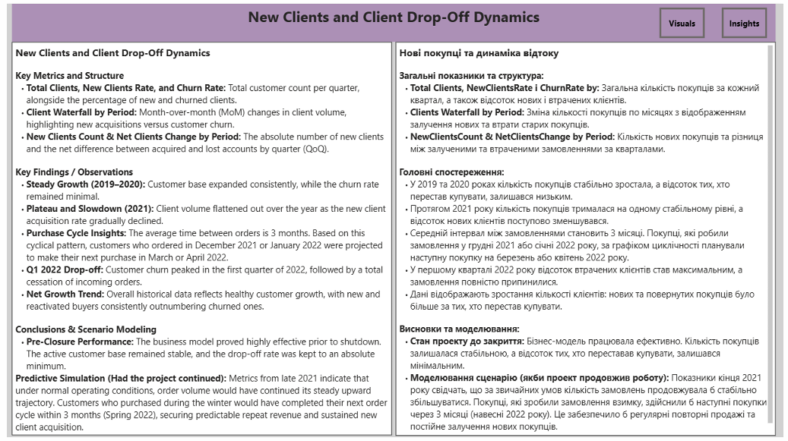

# 📊 Детальний звіт з залучення нових клієнтів та динаміки відтоку (Звіт 3)

## 🎯 Навіщо компанії аналізувати приріст та відтік клієнтів
*   **Перевірка реального зростання (Чистий приріст):** Компанія може залучати тисячі нових клієнтів, але якщо при цьому йде стільки ж або більше, бізнес стоїть на місці. Цей аналіз показує реальний баланс аудиторії.
*   **Вчасне виявлення системних проблем:** Різке зростання кількості втрачених клієнтів — це головний випереджаючий індикатор того, що з продуктом, сервісом чи умовами щось пішло не так. Аналіз дозволяє зафіксувати цей момент до того, як компанія зазнає значних збитків.
*   **Визначення стратегічного фокуса:** Керівництву потрібно чітко знати, на що спрямувати обмежені ресурси: на утримання старої аудиторії (*Retention*) чи на активне залучення нової (*Acquisition*).

---

## 1. Нові покупці та динаміка відтоку

**New Clients and Client Drop-Off Dynamics**

### 🔍 Що аналізується:
*   **Total Clients, NewClientsRate i ChurnRate by Period:** кількість активних покупців за кварталами, відсоток тих, хто купує вперше, та відсоток тих, хто перестав купувати.
*   **NewClientsCount & NetClientsChange by Period:** порівняння кількості покупців, які прийшли вперше, із чистою зміною кількості клієнтів за кварталами.
*   **Clients Waterfall by Period:** помісячні зміни кількості покупців через додавання нових та втрату тих, хто припинив покупки.

### 📈 Результати аналізу:
*   **2018–2020 роки:** Кількість покупців постійно збільшувалася і досягла свого піка наприкінці 2020 року. При цьому відсоток тих, хто купує вперше, був стабільно високим, а показник відтоку — мінімальним.
*   **2021 рік:** Кількість покупців почала помірно зменшуватися. Покупців, які прийшли вперше, ставало менше, а тих, хто перестав купувати — більше.
*   **Початок 2022 року:** Загальна кількість покупців стрімко впала. Відсоток тих, хто купує вперше, знизився до мінімуму, а відсоток тих, хто перестав купувати, досяг 100%.

### 🖥️ Візуалізація дашборду:

---

### 💡 Висновки та бізнес-логіка:

*   Кількість покупців стабільно збільшувалася до кінця 2020 року, але на початку 2022 року ситуація змінилася на стрімке зменшення клієнтів. Тих, хто починає купувати вперше, на фінальному етапі занадто мало, і вони не могли перекрити ту кількість покупців, які перестали робити замовлення.
*   **Важлива аналітична примітка:** Показник тих, хто перестав купувати, піднявся до 100% виключно тому, що компанія припинила діяльність. Покупці, які здійснювали замовлення у грудні, січні та лютому, просто фізично не змогли зробити свої наступні покупки, які за стандартним тримісячним інтервалом аналізу мали припасти на весну.

---

## 🔮 Прогнозний сценарій
Що було б, якби компанія не призупинила діяльність через форс-мажорні обставини у березні 2022 року:
*   **Очікувані замовлення:** У 2021 році кількість покупців, які припиняли покупки, перевищила кількість тих, хто прийшов уперше. Однак компанія все одно зберігала велику кількість постійних лояльних клієнтів, які продовжували робити регулярні замовлення і мали купувати надалі.
*   **Збереження кількості покупців:** Протягом останніх трьох кварталів 2021 року загальна чисельність клієнтів, які роблять покупки, зафіксувалася на одному рівні. Прогноз передбачав збереження цієї стабільної кількості клієнтів надалі.
*   **Очікуваний баланс:** Надалі кількість нових покупців та тих, хто припиняє покупки, мала б вирівнятися і дорівнювати один одному щомісяця. Завдяки цьому загальна чисельність клієнтів продовжувала б залишатися незмінною, на стабільному рівні кінця 2021 року.

---
ℹ️ *Довідкова примітка до звіту: Даний аналіз здійснений за весь час існування проєкту. Компанія працювала в Україні та призупинила діяльність у березні 2022 року через форс-мажорні обставини.*
