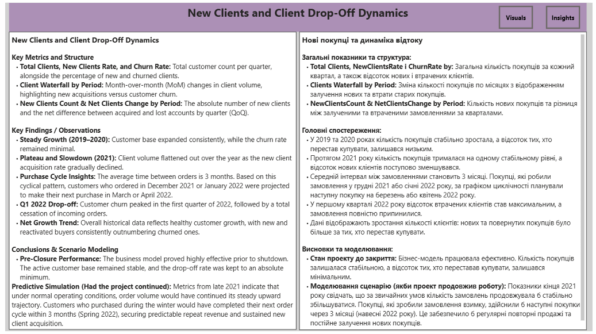

# 📊 New Customer Acquisition and Churn Dynamics (Report 3)

This report condenses growth velocity, audience lifecycles, and database health metrics onto a single interactive panel for accelerated C-suite evaluation.

---

## 🎯 Strategic Value of Acquisition vs. Attrition Mapping
*   **Validating Net Growth:** A business can acquire thousands of accounts, but if attrition outpaces sign-ups, net growth is negative. This visual calculates the absolute net change.
*   **Early Warning Indicator:** A sudden spike in customer drop-off serves as a leading indicator of underlying issues in product quality, customer service, or changing market conditions, allowing correction before financial losses materialize.
*   **Resource Allocation:** Provides leadership with data to balance acquisition budgets against retention structures, maximizing total customer equity.

---

## 1. New Client Inflow and Churn Dynamics

**New Clients and Client Drop-Off Dynamics**

### 🔍 What is Analyzed:
*   **Total Clients, NewClientsRate & ChurnRate by Period:** Active quarterly customer volume compared against new signup percentages and account deactivation rates.
*   **NewClientsCount & NetClientsChange by Period:** Baseline client signups cross-referenced against absolute net variations across quarters.
*   **Clients Waterfall by Period:** Monthly stepping visualizations mapping exact database gains and losses.

### 📈 Performance Assessment:
*   **2018–2020:** Strong upward trajectory, peaking in Q4 2020. Acquisition rates remained high while attrition metrics neared zero.
*   **2021:** Moderate cooling phase. Inflow volume dipped slightly while deactivation patterns showed an upward trend.
*   **Early 2022:** Severe drop in active accounts. Inflow metrics bottomed out while attrition metrics reached 100%.

### 🖥️ Dashboard Visualization:

---

### 💡 Analytical Conclusions & Context:

*   The database grew soundly until the end of 2020, after which acquisition volume softened, failing to completely offset standard market churn throughout 2021.
*   **Critical Analytical Context:** The 100% churn rate recorded in early 2022 is an external anomaly caused entirely by the sudden suspension of corporate operations. Customers who purchased in late winter were physically unable to execute standard re-orders during their typical three-month consumption cycle due to force majeure events.

---

## 🔮 Predictive Forecast Scenario
Modeled database projection assuming operations had proceeded without force majeure disruption in March 2022:
*   **Expected Order Value:** While 2021 churn slightly outpaced new user signups, the business retained a massive, deeply loyal core of returning buyers driving highly predictable repeat transaction models.
*   **Database Stabilization:** During the final three quarters of 2021, active customer volumes stabilized flatly. The predictive algorithm maps a continuation of this stable baseline.
*   **Equilibrium Model:** Moving forward, monthly acquisition was projected to achieve equilibrium with standard monthly attrition, maintaining a steady total active user base matching late 2021 performance.

---
ℹ️ *Reference Note: This analysis evaluates the entire operational lifecycle of the project. The company operated in Ukraine and suspended activities in March 2022 due to force majeure circumstances.*
